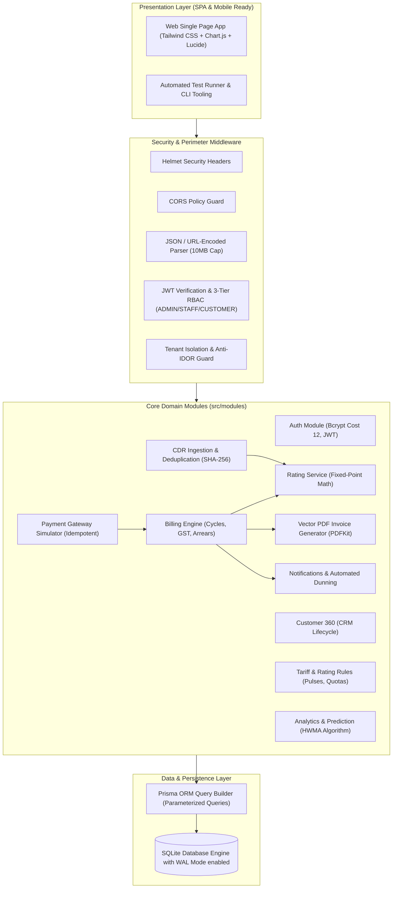
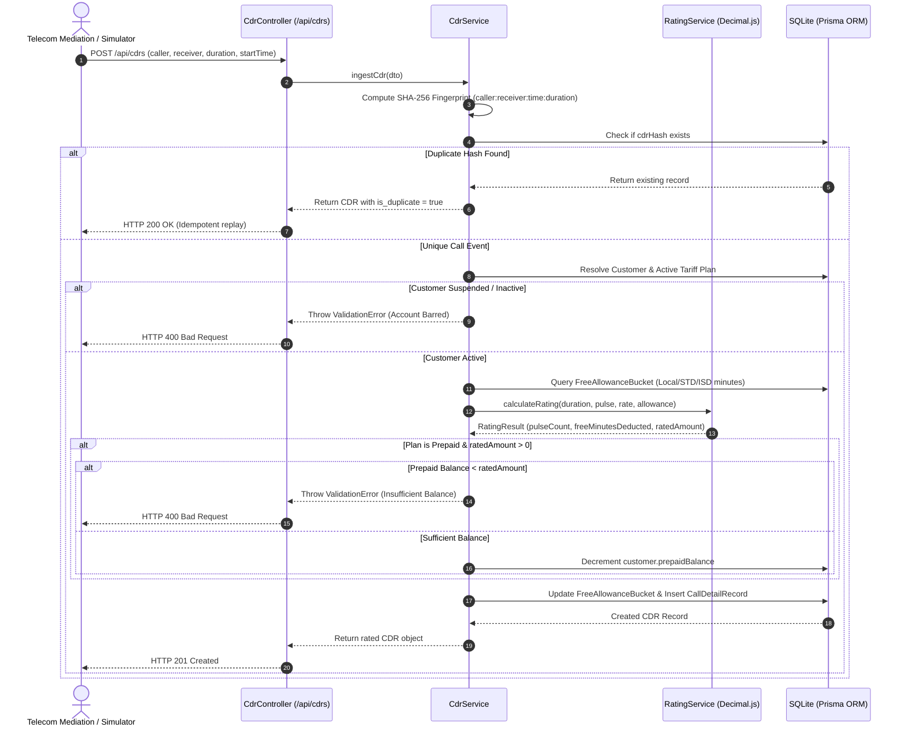
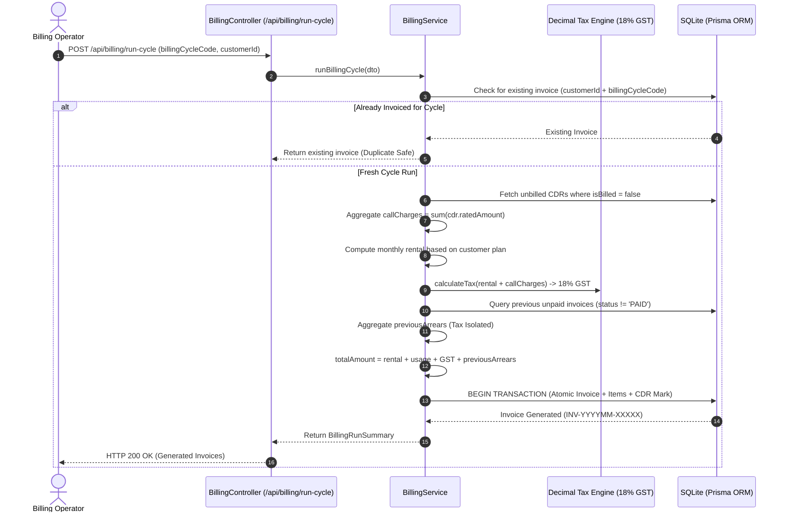

# TeleBill Pro — System Architecture & Design Specification

## 1. Architectural Paradigm: Modular Monolith

TeleBill Pro is architected as a **Modular Monolith** using TypeScript and Node.js. 

Rather than fragmenting a student/prototype application into overengineered microservices with network latency, distributed transactions, and RPC overhead, the system encapsulates domain logic into strict, decoupled, and independently testable modules within a single high-performance Express application runtime.



---

## 2. Directory Structure & Module Layout

The codebase enforces strict separation of concerns:

```
c:\Users\soman\OneDrive\Desktop\Innovative project\
├── prisma/
│   ├── schema.prisma           # 11-table relational data model
│   └── seed.ts                 # Idempotent database seeding engine
├── public/                     # Client-side SPA web assets
│   ├── index.html              # Modern Tailwind dashboard layout
│   ├── styles.css              # Custom design system classes
│   └── app.js                  # Interactive client-side application logic
├── src/
│   ├── app.ts                  # Express application setup & middleware pipeline
│   ├── server.ts               # HTTP listener & graceful shutdown coordinator
│   ├── modules/
│   │   ├── auth/               # Bcrypt password hashing, JWT sessions, RBAC guards
│   │   ├── customers/          # Subscriber onboarding, lifecycle state machine, CRM 360
│   │   ├── tariffs/            # Multi-tier pricing rules, pulses, allowance buckets
│   │   ├── rating/             # Fixed-point deterministic rating math (Decimal.js)
│   │   ├── cdr/                # Single/batch CSV ingestion, SHA-256 hash, Poisson simulator
│   │   ├── billing/            # Postpaid monthly cycle engine, GST tax, PDF invoices
│   │   ├── payments/           # Simulated gateway, idempotency checks, wallet credits
│   │   ├── analytics/          # Live KPIs, revenue trends, HWMA bill prediction
│   │   └── notifications/      # In-app alerts, 24h deduplication throttling
│   └── shared/
│       ├── config/             # Environment validation and company settings
│       ├── database/           # Prisma client singleton and WAL mode pragmas
│       ├── errors/             # AppError taxonomy (ValidationError, NotFoundError, etc.)
│       ├── middleware/         # Auth, RBAC, error handling, tenant perimeter guards
│       ├── types/              # Domain models, enums, DTOs, and interfaces
│       └── utils/              # Decimal.js financial math helpers
├── tests/
│   ├── unit/                   # Unit test suites (Bcrypt, JWT, Decimal.js)
│   ├── integration/            # Relational database, WAL mode, RBAC, IDOR tests
│   └── e2e/                    # Opaque-box E2E test suites (Tiers 1, 2, 3, 4)
└── docs/                       # Comprehensive academic & engineering documentation
```

---

## 3. Core Data Flow Pipelines

### A. Call Detail Record (CDR) Ingestion & Rating Sequence



---

### B. Monthly Billing Run & Invoice Settlement Sequence



---

## 4. Dual Routing Compatibility Contract

To accommodate standard RESTful convention alongside backward compatibility with external testing harnesses, all domain modules are dual-mounted in `src/app.ts`:
- Canonical Root: `/api/{resource}`
- Versioned Root: `/api/v1/{resource}`

Any request addressed to `/api/customers` or `/api/v1/customers` resolves to the identical controller action, preventing fragile route mismatches during integration testing.

---

## 5. Concurrency Model: SQLite Write-Ahead Logging (WAL)

Standard SQLite configurations execute in `DELETE` journal mode, locking the entire database during write transactions and causing `SQLITE_BUSY` errors under concurrent traffic.

TeleBill Pro activates SQLite Write-Ahead Logging (WAL) pragmas on database connection initialization (`src/shared/database.ts`):
```sql
PRAGMA journal_mode = WAL;
PRAGMA busy_timeout = 5000;
PRAGMA synchronous = NORMAL;
PRAGMA foreign_keys = ON;
```

### Engineering Implications:
1. **Concurrent Non-Blocking Reads:** Readers do not block writers, and writers do not block readers. Subscribers can inspect their live dashboards while automated billing runs write thousands of invoice line items.
2. **Busy Timeout Resilience:** If two threads attempt concurrent writes, SQLite waits up to 5000 milliseconds for lock release before throwing `SQLITE_BUSY`.
3. **Data Durability:** `synchronous = NORMAL` in WAL mode provides ACID compliance without the severe disk sync performance penalty of `FULL`.
