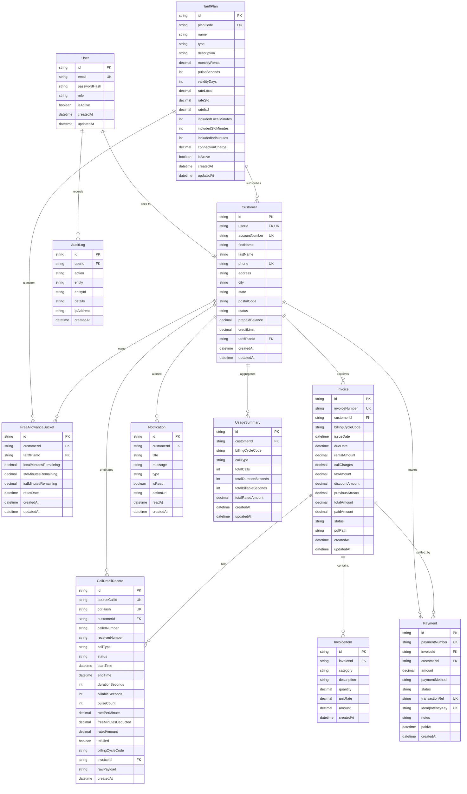

# TeleBill Pro — Database Design & Schema Specification

## 1. Entity-Relationship (ER) Architecture

The TeleBill Pro database comprises **11 relational tables** designed in third normal form (3NF). The schema enforces foreign key constraints, cascading deletions, unique indexes, and audit traceability.

---

## 2. Comprehensive Data Dictionary

### Table 1: `users`
Stores system authentication credentials, access roles, and account active state.
- `id` (VARCHAR(36), PK): Primary Key UUID.
- `email` (VARCHAR(255), UNIQUE, NOT NULL): Canonical user email address.
- `passwordHash` (VARCHAR(255), NOT NULL): Bcrypt cryptographic password hash (Cost Factor 12).
- `role` (VARCHAR(50), DEFAULT 'CUSTOMER'): User authorization role (`ADMIN`, `STAFF`, `CUSTOMER`).
- `isActive` (BOOLEAN, DEFAULT true): Flag indicating whether the account can log in.
- `createdAt` / `updatedAt` (DATETIME): Automatic lifecycle audit timestamps.

### Table 2: `customers`
Stores subscriber profiles, demographics, telecom account numbers, MSISDN, and wallet balances.
- `id` (VARCHAR(36), PK): Customer UUID.
- `userId` (VARCHAR(36), UNIQUE, FK -> `users.id`): 1-to-1 link to user authentication entity.
- `accountNumber` (VARCHAR(50), UNIQUE, NOT NULL): Formatted identifier `TEL-YYYYMM-XXXXX`.
- `firstName` / `lastName` (VARCHAR(100), NOT NULL): Subscriber full name.
- `phone` (VARCHAR(50), UNIQUE, NOT NULL): Subscriber telephone number (MSISDN).
- `address` / `city` / `state` / `postalCode` (VARCHAR): Physical billing address.
- `status` (VARCHAR(50), DEFAULT 'ACTIVE'): Lifecycle state (`ACTIVE`, `SUSPENDED`, `INACTIVE`).
- `prepaidBalance` (DECIMAL(10,2), DEFAULT 0.00): Current prepaid talktime wallet balance in INR.
- `creditLimit` (DECIMAL(10,2), DEFAULT 2000.00): Maximum postpaid arrears ceiling before suspension.
- `tariffPlanId` (VARCHAR(36), FK -> `tariff_plans.id`): Active assigned tariff plan.

### Table 3: `tariff_plans`
Stores configurable telecom pricing rules, pulse intervals, call rates, and included quotas.
- `id` (VARCHAR(36), PK): Plan UUID.
- `planCode` (VARCHAR(50), UNIQUE, NOT NULL): Identifier code (e.g. `POST-STD-299`, `PRE-VAL-199`).
- `name` (VARCHAR(150), NOT NULL): Descriptive commercial name.
- `type` (VARCHAR(50), NOT NULL): Plan category (`PREPAID`, `POSTPAID`).
- `monthlyRental` (DECIMAL(10,2), DEFAULT 0.00): Recurring fixed monthly fee in INR.
- `pulseSeconds` (INT, DEFAULT 60): Billing increment in seconds (e.g. 60s or 1s per-second pulse).
- `validityDays` (INT, NULLABLE): Days of validity for prepaid vouchers; null for monthly postpaid.
- `rateLocal` (DECIMAL(10,4), NOT NULL): Rate per minute for local calls in INR.
- `rateStd` (DECIMAL(10,4), NOT NULL): Rate per minute for STD national calls in INR.
- `rateIsd` (DECIMAL(10,4), NOT NULL): Rate per minute for ISD international calls in INR.
- `includedLocalMinutes` / `includedStdMinutes` / `includedIsdMinutes` (INT, DEFAULT 0): Free allowances.
- `isActive` (BOOLEAN, DEFAULT true): Plan availability toggle.

### Table 4: `free_allowance_buckets`
Tracks remaining free allowance minutes per subscriber per plan.
- `id` (VARCHAR(36), PK): Bucket UUID.
- `customerId` (VARCHAR(36), FK -> `customers.id`, CASCADE): Linked subscriber.
- `tariffPlanId` (VARCHAR(36), FK -> `tariff_plans.id`): Associated tariff plan.
- `localMinutesRemaining` / `stdMinutesRemaining` / `isdMinutesRemaining` (DECIMAL(10,4)): Remaining free minutes.
- `resetDate` (DATETIME, NOT NULL): Date when free minute quota automatically replenishes.
- **Compound Unique Constraint:** `UNIQUE(customerId, tariffPlanId)`.

### Table 5: `call_detail_records`
Stores telecom call events rated with fixed-point arithmetic and SHA-256 deduplication fingerprints.
- `id` (VARCHAR(36), PK): CDR UUID.
- `sourceCallId` (VARCHAR(100), UNIQUE): Network probe call reference.
- `cdrHash` (VARCHAR(64), UNIQUE, NOT NULL): Cryptographic fingerprint `SHA256(caller:receiver:time:duration)`.
- `customerId` (VARCHAR(36), FK -> `customers.id`, CASCADE): Calling subscriber.
- `callerNumber` / `receiverNumber` (VARCHAR(50), NOT NULL): Originating and terminating MSISDNs.
- `callType` (VARCHAR(50), NOT NULL): Destination category (`LOCAL`, `STD`, `ISD`).
- `status` (VARCHAR(50), DEFAULT 'COMPLETED'): Connection status (`COMPLETED`, `BUSY`, `NO_ANSWER`, `FAILED`).
- `startTime` / `endTime` (DATETIME, NOT NULL): Call start and end timestamps.
- `durationSeconds` (INT, NOT NULL): Actual call duration in seconds.
- `billableSeconds` (INT, NOT NULL): Quantized billable seconds based on plan pulse increment.
- `pulseCount` (INT, NOT NULL): Computed number of pulses charged (`billableSeconds / pulseSeconds`).
- `ratePerMinute` (DECIMAL(10,4), NOT NULL): Snapshot of applied rate at call ingestion time.
- `freeMinutesDeducted` (DECIMAL(10,4), DEFAULT 0.0000): Number of free allowance minutes used.
- `ratedAmount` (DECIMAL(10,4), DEFAULT 0.0000): Computed financial charge in INR.
- `isBilled` (BOOLEAN, DEFAULT false): Flag indicating whether CDR has been aggregated into an invoice.
- `billingCycleCode` (VARCHAR(50), NULLABLE): Cycle code in which CDR was billed.
- `invoiceId` (VARCHAR(36), FK -> `invoices.id`, NULLABLE): Generated invoice linkage.

### Table 6: `invoices`
Stores aggregated monthly postpaid tax invoices with statutory GST calculations.
- `id` (VARCHAR(36), PK): Invoice UUID.
- `invoiceNumber` (VARCHAR(50), UNIQUE, NOT NULL): Formatted identifier `INV-YYYYMM-XXXXX`.
- `customerId` (VARCHAR(36), FK -> `customers.id`, CASCADE): Billed subscriber.
- `billingCycleCode` (VARCHAR(50), NOT NULL): Billing cycle identifier (e.g. `2026-11`).
- `issueDate` / `dueDate` (DATETIME, NOT NULL): Date of bill issuance and payment deadline.
- `rentalAmount` (DECIMAL(10,2), NOT NULL): Fixed plan rental charge.
- `callCharges` (DECIMAL(10,2), NOT NULL): Aggregate rated usage charges for cycle.
- `taxAmount` (DECIMAL(10,2), NOT NULL): Statutory 18% GST assessed strictly on taxable subtotal.
- `discountAmount` (DECIMAL(10,2), DEFAULT 0.00): Promotional credits applied.
- `previousArrears` (DECIMAL(10,2), DEFAULT 0.00): Previous unpaid delinquent balances rolled over without tax.
- `totalAmount` (DECIMAL(10,2), NOT NULL): Total payable amount in INR.
- `paidAmount` (DECIMAL(10,2), DEFAULT 0.00): Realized settled payment sum.
- `status` (VARCHAR(50), DEFAULT 'UNPAID'): Status (`UNPAID`, `PARTIALLY_PAID`, `PAID`, `OVERDUE`).
- `pdfPath` (VARCHAR(255), NULLABLE): Server filesystem path to generated PDF invoice document.
- **Compound Unique Constraint:** `UNIQUE(customerId, billingCycleCode)`.

### Table 7: `invoice_items`
Itemized line-item ledger providing full auditable breakdown for invoices.
- `id` (VARCHAR(36), PK): Item UUID.
- `invoiceId` (VARCHAR(36), FK -> `invoices.id`, CASCADE): Parent invoice.
- `category` (VARCHAR(50), NOT NULL): Line type (`RENTAL`, `USAGE`, `TAX`, `ARREARS`, `DISCOUNT`).
- `description` (VARCHAR(255), NOT NULL): Plain-English narrative for the charge.
- `quantity` (DECIMAL(10,4), NOT NULL): Units consumed.
- `unitRate` (DECIMAL(10,4), NOT NULL): Unit pricing applied.
- `amount` (DECIMAL(10,2), NOT NULL): Line monetary charge in INR.

### Table 8: `payments`
Atomic ledger tracking simulated payment gateway transactions and wallet credits.
- `id` (VARCHAR(36), PK): Payment UUID.
- `paymentNumber` (VARCHAR(50), UNIQUE, NOT NULL): Formatted payment receipt number `PAY-YYYYMMDD-XXXXX`.
- `invoiceId` (VARCHAR(36), FK -> `invoices.id`, NULLABLE): Settled invoice, or null for direct recharge.
- `customerId` (VARCHAR(36), FK -> `customers.id`, CASCADE): Paying subscriber.
- `amount` (DECIMAL(10,2), NOT NULL): Transaction amount in INR.
- `paymentMethod` (VARCHAR(50), NOT NULL): Method (`UPI`, `CREDIT_CARD`, `NET_BANKING`, `SIMULATED`).
- `status` (VARCHAR(50), DEFAULT 'SUCCESS'): Payment gateway outcome (`SUCCESS`, `DECLINED`, `REFUNDED`).
- `transactionRef` (VARCHAR(100), UNIQUE, NOT NULL): External gateway transaction reference `TXN-YYYYMMDD-XXXXXX`.
- `idempotencyKey` (VARCHAR(100), UNIQUE, NOT NULL): Unique key guaranteeing idempotent replays.
- `paidAt` (DATETIME): Timestamp of confirmed settlement.

### Table 9: `notifications`
In-app subscriber notifications, automated dunning alerts, and low-balance warnings.
- `id` (VARCHAR(36), PK): Notification UUID.
- `customerId` (VARCHAR(36), FK -> `customers.id`, CASCADE): Target subscriber.
- `title` / `message` (VARCHAR): Notification content and actionable instructions.
- `type` (VARCHAR(50), NOT NULL): Alert type (`BILL_DUE`, `OVERDUE`, `LOW_BALANCE`, `PAYMENT_CONFIRMATION`).
- `isRead` (BOOLEAN, DEFAULT false): Read status toggle.
- `readAt` (DATETIME, NULLABLE): Timestamp when subscriber read the alert.

### Table 10: `usage_summaries`
Aggregated daily and monthly usage summaries for accelerated dashboard and reporting queries.
- `id` (VARCHAR(36), PK): Summary UUID.
- `customerId` (VARCHAR(36), FK -> `customers.id`, CASCADE): Target subscriber.
- `billingCycleCode` (VARCHAR(50), NOT NULL): Aggregation window identifier.
- `callType` (VARCHAR(50), NOT NULL): Destination category (`LOCAL`, `STD`, `ISD`).
- `totalCalls` (INT, DEFAULT 0): Total number of calls placed.
- `totalDurationSeconds` / `totalBillableSeconds` (INT, DEFAULT 0): Aggregate seconds.
- `totalRatedAmount` (DECIMAL(10,4), DEFAULT 0.0000): Monetary total in INR.
- **Compound Unique Constraint:** `UNIQUE(customerId, billingCycleCode, callType)`.

### Table 11: `audit_logs`
Append-only tamper-evident operational log recording administrative changes.
- `id` (VARCHAR(36), PK): Audit record UUID.
- `userId` (VARCHAR(36), FK -> `users.id`, NULLABLE): Originating authenticated user.
- `action` (VARCHAR(100), NOT NULL): Action identifier (e.g. `CUSTOMER_CREATE`, `TARIFF_UPDATE`, `BILLING_RUN`).
- `entity` (VARCHAR(100), NOT NULL): Target domain entity (`Customer`, `TariffPlan`, `Invoice`).
- `entityId` (VARCHAR(100), NOT NULL): Affected primary record identifier.
- `details` (TEXT, NOT NULL): JSON-serialized payload detailing state mutations.
- `ipAddress` (VARCHAR(50)): Client IP address.
- `createdAt` (DATETIME, DEFAULT now()): Immutability timestamp.

---

## 3. Database Indexes & Query Optimizations

To ensure sub-50ms operational response times, targeted indexes are declared in `prisma/schema.prisma`:
1. `call_detail_records(customerId, isBilled)`: Optimizes unbilled CDR aggregation during monthly billing runs.
2. `call_detail_records(customerId, startTime)`: Speeds up customer call history and heatmap analytics queries.
3. `invoices(customerId, status)`: Accelerates outstanding balance and delinquent arrears queries.
4. `notifications(customerId, isRead, createdAt)`: Enables instantaneous unread alert polling.
5. `payments(customerId, createdAt)`: Optimizes subscriber transaction history lookups.
