# TeleBill Pro — Implementation Roadmap & Milestone Audit Log

## 1. Project Implementation Phases

```mermaid
flowchart LR
    P1["Phase 1: Environment & Toolchain"] --> P2["Phase 2: Database Schema & WAL"]
    P2 --> P3["Phase 3: Auth & Security"]
    P3 --> P4["Phase 4: Rating & CRM Core"]
    P4 --> P5["Phase 5: CDR & Traffic Sim"]
    P5 --> P6["Phase 6: Billing & PDF Invoices"]
    P6 --> P7["Phase 7: Payment Gateway"]
    P7 --> P8["Phase 8: Analytics & HWMA"]
    P8 --> P9["Phase 9: Dunning & Alerts"]
    P9 --> P10["Phase 10: Responsive Web UI"]
    P10 --> P11["Phase 11: 232/232 Test Pass"]
    P11 --> P12["Phase 12: Academic Defense & Deck"]
```

---

## 2. Milestone Execution Audit Log

| Phase | Milestone Name | Scope of Implementation & Deliverables | Verification Status |
| :--- | :--- | :--- | :--- |
| **Phase 1** | **Scaffolding & Toolchain** | Node.js v20.18.1 LTS portable runtime established in `$env:LOCALAPPDATA\Programs\nodejs`. TypeScript 5.6.3 compiler setup, ESLint, Prettier, and Jest 29.7. | ✅ Complete |
| **Phase 2** | **Relational Database & WAL** | 11 relational tables modeled in `prisma/schema.prisma` with foreign key cascades, unique constraints, and WAL mode pragmas. Automated seed engine in `prisma/seed.ts`. | ✅ Complete |
| **Phase 3** | **Security & Authentication** | Bcrypt cost factor 12 password hashing, timing-attack dummy hash, HS256 JWT tokens (60m lifespan), 3-tier RBAC (`ADMIN`, `STAFF`, `CUSTOMER`), IDOR perimeter checks. | ✅ Complete |
| **Phase 4** | **Rating & CRM Core** | `customer.service.ts` with lifecycle state machine (`ACTIVE`, `SUSPENDED`, `INACTIVE`), `tariff.service.ts` with configurable pulse intervals and multi-tier pricing, `rating.service.ts` with fixed-point math (`decimal.js`). | ✅ Complete |
| **Phase 5** | **CDR & Traffic Simulator** | Single CDR ingestion, streaming CSV file parser, cryptographic SHA-256 deduplication hashing, and Poisson synthetic traffic simulator with log-normal durations. | ✅ Complete |
| **Phase 6** | **Billing Engine & PDF Invoicing** | Monthly postpaid billing cycle engine (`/api/billing/run-cycle`), duplicate invoice prevention (`UNIQUE(customerId, billingCycleCode)`), 18% GST tax assessment, arrears debt rollover without double taxation, vector PDF generation via `pdfkit`. | ✅ Complete |
| **Phase 7** | **Payment Gateway Simulation** | Simulated checkout (`/api/payments/simulate`), idempotency key verification, atomic settlement, automatic prepaid wallet credit on overpayment, direct balance top-ups. | ✅ Complete |
| **Phase 8** | **Analytics & Bill Prediction** | Executive dashboard KPIs, accounts receivable aging buckets (0-30, 31-60, 61-90, 90+ days), customer growth metrics, and hybrid HWMA bill prediction engine with natural language explanation narratives. | ✅ Complete |
| **Phase 9** | **Notifications & Dunning** | In-app alerts, upcoming due date reminders, overdue dunning notices, low prepaid balance alerts, and 24-hour deduplication throttling. | ✅ Complete |
| **Phase 10** | **Responsive Web UI** | Modern Single Page Application in `public/index.html` with Tailwind CSS, Lucide icons, Chart.js graphs, 1-click demo role switcher, customer management drawers, and modal forms. | ✅ Complete |
| **Phase 11** | **Exhaustive Automated Testing** | 25 unit tests, 89 integration tests, and 118 E2E tests across 4 tiers (T1 Feature Coverage, T2 Boundaries, T3 Cross-Feature, T4 Real-World Workloads). 232/232 tests passing (100%). | ✅ Complete |
| **Phase 12** | **Academic Defense Suite** | Complete documentation suite in `docs/`, 26-question viva preparation guide, and 15-slide PowerPoint presentation deck (`docs/telebill-pro-presentation.pptx`). | ✅ Complete |
