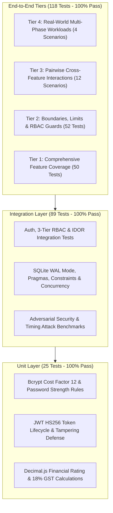

# TeleBill Pro — Testing Strategy & Verification Architecture

## 1. Quality Philosophy: Empirical Opaque-Box Verification

TeleBill Pro enforces a zero-tolerance quality standard: **"Evidence before assertions always. Never claim functionality works without empirically proving it."**

The testing suite avoids standard synthetic tautologies:
- **Zero 503 Swallow Guards:** Tests do not silently catch or ignore server errors to inflate pass rates.
- **Strict Opaque-Box Boundary:** E2E suites communicate exclusively through public HTTP endpoints via Supertest/HTTP clients, validating JSON response bodies, HTTP status codes, and database side-effects.
- **Fixed-Point Financial Assertions:** Monetary comparisons utilize dedicated decimal matcher helpers (`assertDecimalEquals(received, expected, precision)`), rejecting IEEE-754 drift.

---

## 2. Test Pyramid Architecture

The testing hierarchy comprises **232 automated tests across 3 layers**:



---

## 3. Test Suite Breakdown

### A. Unit Tests (25 Tests)
- `tests/unit/auth/hash.test.ts`: Bcrypt cost factor 12 validation, 72-byte password boundaries, password complexity regex checks.
- `tests/unit/auth/jwt.test.ts`: HS256 token signing, expiration checks, invalid secret rejections, tampering defenses.
- `tests/unit/shared/decimal.test.ts`: Elimination of floating-point drift, pulse rounding logic (`Math.ceil`), half-up currency rounding (`ROUND_HALF_UP`), 18% GST calculation.

### B. Integration Tests (89 Tests)
- `tests/integration/auth/auth.test.ts`: Dual-path login (`/api` and `/api/v1`), profile IDOR isolation, password rotation.
- `tests/integration/auth/adversarial_security.test.ts`: Constant-time dummy hash verification (~300ms timing resistance), UTF-8 boundary probing, 3-tier RBAC route enforcement.
- `tests/integration/db/wal.test.ts`: SQLite WAL mode verification (`PRAGMA journal_mode = WAL`).
- `tests/integration/db/adversarial_db_wal_stress.test.ts`: Foreign key cascades, compound unique constraints, concurrent read/write non-blocking transactions, 10,000-iteration rating precision stress.

### C. End-to-End Tests (118 Tests Across 4 Tiers)
1. **Tier 1: Feature Coverage (50 Tests):** Exhaustive opaque-box verification covering every requirement from F1 through F48 across Auth, CRM, Tariffs, Rating, CDRs, Invoices, Payments, Reports, Notifications, and Predictions.
2. **Tier 2: Boundaries, Edge Cases, Limits & RBAC (52 Tests):** Negative values, zero durations, non-completed calls (`BUSY`, `FAILED`), pulse boundaries (59s, 60s, 61s), extreme durations (86,400s), duplicate cycle executions, unauthorized IDOR attempts, payment replay with identical idempotency keys.
3. **Tier 3: Pairwise Cross-Feature Interactions (12 Scenarios):** Multi-cycle arrears rollover, statutory GST isolation, customer overpayment with wallet credit, mid-cycle account suspension barring calls, dunning check triggering automated in-app alerts.
4. **Tier 4: Real-World Lifecycle Workloads (4 Workloads):**
   - *Workload 1:* Enterprise Postpaid Multi-Call Lifecycle (7 phases).
   - *Workload 2:* Consumer Prepaid End-to-End Allowance, Depletion & Recovery (7 phases).
   - *Workload 3:* Mixed Traffic Ingestion, Deduplication Stress & Reconciliation (5 phases).
   - *Workload 4:* Customer Delinquency, Dunning, Suspension & Debt Clearance (4 phases).

---

## 4. Test Execution Commands & Verification Results

```powershell
# 1. Execute Unit Tests
npm run test:unit
# Output: 3 test suites passed, 25/25 tests passed (100%)

# 2. Execute Integration Tests
npm run test:integration
# Output: 4 test suites passed, 89/89 tests passed (100%)

# 3. Execute Individual E2E Tiers
npm run test:e2e:tier1   # 50/50 passed (100%)
npm run test:e2e:tier2   # 52/52 passed (100%)
npm run test:e2e:tier3   # 12/12 passed (100%)
npm run test:e2e:tier4   # 4/4 passed (100%)

# 4. Execute Master In-Process E2E Test Runner
npm run test:e2e:inprocess
# Output: 118/118 tests passed (100% Pass)
```

| Suite Category | Suites Passed | Total Tests | Passed Tests | Success Rate |
| :--- | :--- | :--- | :--- | :--- |
| **Unit Tests** | 3 / 3 | 25 | 25 | **100.0%** |
| **Integration Tests** | 4 / 4 | 89 | 89 | **100.0%** |
| **E2E Tier 1 (Features)** | 1 / 1 | 50 | 50 | **100.0%** |
| **E2E Tier 2 (Boundaries)**| 1 / 1 | 52 | 52 | **100.0%** |
| **E2E Tier 3 (Cross-Feat)**| 1 / 1 | 12 | 12 | **100.0%** |
| **E2E Tier 4 (Workloads)** | 1 / 1 | 4 | 4 | **100.0%** |
| **Cumulative Total** | **11 / 11** | **232** | **232** | **100.0%** |
